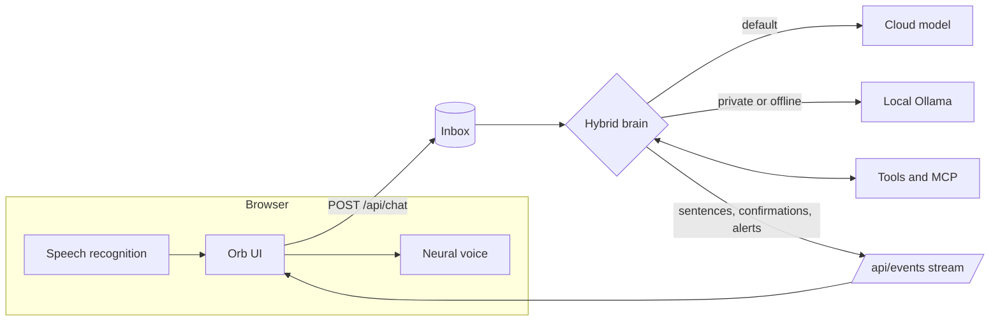
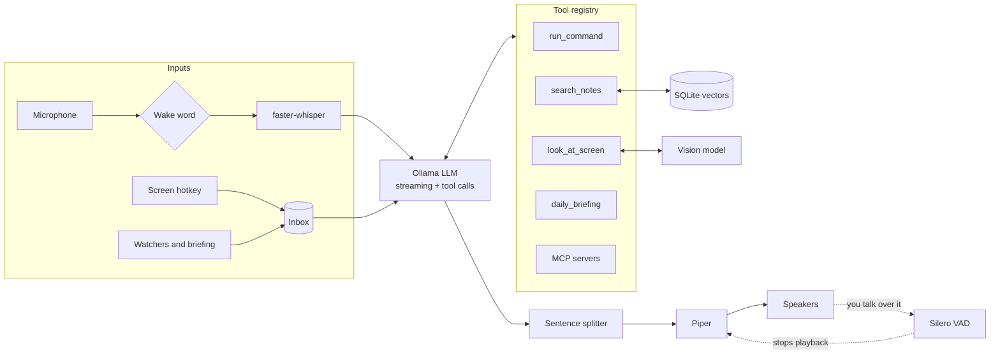

# Jarvis

A personal voice assistant for developers. It talks back while it's still thinking, and you can cut it off mid-sentence. It answers from your own notes and code, looks at your screen when you ask, plugs into apps through the Model Context Protocol, and speaks up on its own when something needs your attention.

It runs two ways:

- **In your browser** (`jarvis --web`). The browser listens and speaks with natural neural voices, a fast cloud model does the thinking, and your own Ollama takes over when you flip the Private switch or the cloud is down. Replies start in about a second, even on an 8 GB laptop with no GPU.
- **Fully local** (`jarvis --local`). Whisper, Piper and Ollama on your machine, nothing leaves it. Best with a GPU.

```
You:    "Hey Jarvis, where did I write that auth fix?"
Jarvis: "It's in your notes file auth.md. The token was expiring too early, so you raised the TTL to an hour."

[Ctrl+Alt+J on a red terminal]
Jarvis: "Taking a look. You're missing the requests package. Run pip install requests and try again."

[8:30 am]
Jarvis: "Morning. You've got standup at ten and a design review at two. The jarvis repo has three uncommitted changes."
```

For a plain-language walkthrough of how all of this fits together, read [docs/HOW-IT-WORKS.md](docs/HOW-IT-WORKS.md).

## Features

| Feature | What it does | Built with |
|---|---|---|
| Hybrid brain | Cloud model first for speed, local Ollama as fallback and for private questions. Embeddings and vision always stay local. | Any OpenAI-compatible API (Groq by default), Ollama |
| Command center | A side panel in the browser app with live processor, memory, disk and battery, plus a health check that says what's broken and the exact fix. `jarvis --doctor` prints the same check in the terminal. | psutil, Python standard library |
| Browser app | Push-to-talk, hands-free mode, barge-in, spoken and on-screen confirmations, and a voice picker. | Web Speech API, Server-Sent Events, Python standard library server |
| Streaming voice | Speaks the first sentence while the model is still writing the rest. Optional barge-in lets you interrupt. | Ollama streaming, Piper, Silero VAD |
| MCP agent | Connects to any Model Context Protocol server (files, git, calendar, browser) and exposes its tools to the model. | `mcp` Python SDK |
| Second brain | Indexes your notes, PDFs and code locally and answers questions from them, citing the file. | Ollama embeddings, SQLite, NumPy |
| Screen vision | A hotkey or "look at my screen" sends a screenshot to a local vision model. | mss, Qwen2.5-VL or LLaVA |
| Proactive mode | Battery, disk, meeting and build-log watchers, plus a daily briefing, with quiet hours. | psutil, icalendar |
| Safe actions | Allowlisted shell commands with spoken confirmation, and per-server confirmation for MCP tools. | Pure-Python policy, fully tested |
| Reminders and schedule | "Remind me to call mum at 5", "every weekday at 8", "what's on my schedule today", snooze. Speaks up and pops a desktop notification when one is due, and catches up on ones missed while it was off. | Own time parser, JSON store, no model needed |
| Live knowledge | Weather ("will it rain tomorrow?"), facts from Wikipedia ("who is Ada Lovelace?") and BBC headlines, answered in about a second with no API keys. A Today panel in the browser app shows them at a glance. | Open-Meteo, Wikipedia REST, RSS |
| Memory | "Remember that my standup is at 10:30." Facts persist across restarts and are given to the model in every conversation. | JSON store |
| On your phone | Install Jarvis on your phone's home screen and talk to your laptop from anywhere. Tailscale carries it privately with https, and only phones that scanned the pairing code get in. | PWA, Tailscale, Python standard library |
| Phone alerts | Reminders, battery and build warnings, the morning briefing, and answers you walked away from arrive on your lock screen. Tap one to open Jarvis. | ntfy (free, no account) |
| Telegram | Your own private bot: chat or send voice notes to Jarvis from anywhere, and get the same alerts there. Only your account can use it; the laptop only makes outgoing connections. | Telegram Bot API, Groq Whisper |
| Knows your voice | Read three sentences once; Jarvis then greets you by name and keeps your notes, schedule and memories from voices it doesn't recognise. Only a voiceprint is stored. | WeSpeaker ResNet34 via sherpa-onnx, offline |

Everything is optional and switched on in `config.yaml`, so the basic assistant still runs on a modest laptop.

## Web mode, the quick way to try it

```powershell
pip install -e .                      # the web app needs no extras
setx GROQ_API_KEY "your-key"          # free key from console.groq.com/keys, then open a new terminal
jarvis --web                          # or double-click start-jarvis-web.bat
```

Your browser opens at http://localhost:8765. Tap the orb or press Space and talk, or type. Use Microsoft Edge for the most natural voices (Ryan and Guy sound the most like Jarvis), and pick one in the settings panel.

How it fits together:



Every reply streams back one sentence at a time over Server-Sent Events, so the browser starts speaking the first sentence while the model is still writing the rest. Watcher alerts and the morning briefing come down the same stream. When Jarvis wants to run a command it asks out loud and shows Yes and No buttons; answering by voice works too.

Privacy in web mode: the Private switch keeps the thinking on your machine. Speech recognition in Chrome and Edge uses the browser maker's speech service, so for fully offline voice use `jarvis --local`. The server only listens on 127.0.0.1 and refuses requests from other websites. A paired phone reaches it through Tailscale and must show its pairing key on every request.

To use Jarvis on your phone and get alerts there, see [docs/PHONE.md](docs/PHONE.md).

Any OpenAI-compatible provider works. Change `llm.cloud` in `config.yaml` to use OpenRouter, OpenAI, or Claude through Anthropic's OpenAI-compatible endpoint.

## How it works



### Project layout

```
jarvis/
  cli.py          entry point; wires optional features together
  cloud.py        hybrid brain: OpenAI-compatible streaming client and the local fallback router
  server.py       web mode: local HTTP server, event stream, confirmations
  webui/          the browser app (one HTML file, no build step)
  assistant.py    conversation loop, tool-call loop, inbox
  persona.py      Jarvis's system prompt and the TTS cleanup filter
  llm.py          Ollama client: streaming chat, vision, embeddings
  streaming.py    turns token streams into speakable sentences
  voice.py        Speaker (pipelined synth and playback), Silero VAD, barge-in
  tools.py        tool registry and the shell-command safety policy
  mcp_client.py   connects MCP servers and registers their tools
  knowledge.py    second brain: chunking, embedding, vector search
  vision.py       screenshots, the vision model call, the global hotkey
  watchers.py     battery, disk, meeting and log watchers, briefing, scheduler
  audio.py        shared microphone stream and end-of-speech detection
  stt.py, tts.py, wakeword.py
scripts/
  download_voice.py     fetches a Piper voice
  install_startup.ps1   start Jarvis when you sign in to Windows
tests/                  40 tests, no models, mic or API key needed
```

## Setup

You need Python 3.10 or newer. Disk use depends on what you turn on: about 6 GB for the basics, plus about 6 GB more for vision.

### 1. Install Ollama and the models

Download Ollama from [ollama.com/download](https://ollama.com/download), then pull what you need:

```bash
ollama pull llama3.1:8b          # the brain (required)
ollama pull nomic-embed-text     # second brain (small)
ollama pull qwen2.5vl:7b         # screen vision (needs a GPU with about 8 GB, or try llava:7b)
```

On a machine with less than 16 GB of RAM, use `llama3.2:3b` as the main model.

### 2. Get the code and install

Clone the repo (replace the URL with your own), or download and unzip the source into a folder named `jarvis`.

Windows (PowerShell):

```powershell
Expand-Archive $HOME\Downloads\jarvis.zip -DestinationPath $HOME   # skip if you cloned
cd $HOME\jarvis
python -m venv .venv
.venv\Scripts\Activate.ps1          # if blocked: Set-ExecutionPolicy -Scope CurrentUser RemoteSigned
pip install -e ".[all]"
python scripts\download_voice.py
copy config.example.yaml config.yaml
```

macOS and Linux:

```bash
cd jarvis
python3 -m venv .venv && source .venv/bin/activate
pip install -e ".[all]"
python scripts/download_voice.py
cp config.example.yaml config.yaml
```

Then open `config.yaml` and set your own folders, repos and calendar file. To install only part of it, pick extras instead of `all`, for example `".[voice,brain]"`.

Platform notes:

- **MCP servers** need [Node.js](https://nodejs.org) for `npx` servers and [uv](https://docs.astral.sh/uv/) for `uvx` servers.
- **Linux:** `sounddevice` needs PortAudio: `sudo apt install libportaudio2`. The hotkey needs an X11 session.
- **macOS:** allow microphone, screen recording and accessibility access for your terminal when asked.
- **NVIDIA GPU:** set `stt.device: cuda` and `stt.compute_type: float16` for faster transcription.

### 3. Run it

```bash
jarvis --index             # build the second brain once (later runs update it in the background)
jarvis                     # talk to it
jarvis --wake              # say "Hey Jarvis" first
jarvis --barge-in          # interrupt it by talking (use headphones)
jarvis --briefing          # get the daily briefing right away
jarvis --text              # type instead of talk, handy for testing
jarvis --web               # the browser app
jarvis --local             # never use the cloud model
jarvis --doctor            # health check with a fix for every problem
jarvis --mic-test          # check what Jarvis hears: levels, speech detection, transcript
```

To have it start when you sign in to Windows:

```powershell
powershell -ExecutionPolicy Bypass -File scripts\install_startup.ps1
```

Say "goodbye" to exit.

## Things to say

- "What's my disk space like?" runs a safe command after you say yes.
- "Where did I write about the login bug?" searches your second brain.
- "What did I change in the jarvis repo today?" uses the git MCP server.
- "Look at my screen. Why is this failing?" uses vision. Or just press Ctrl+Alt+J.
- "Brief me." reads today's meetings, repo status and disk.

## The safety model

Letting a language model act on your machine deserves care. Everything goes through one place, `ToolBox.call` in [jarvis/tools.py](jarvis/tools.py).

1. **Shell commands** must be on `allowed_commands`. Pipes, redirects, `;`, `&&`, backticks and `$()` are rejected, commands run with `shell=False`, and destructive arguments like `git push`, `git reset`, `pip uninstall`, `-rf`, `--force` and `python -c` are blocked. Then Jarvis says what it's doing and waits for a spoken yes.
2. **MCP tools** confirm by default. Set `confirm: false` only for read-only servers, and use `allow_tools` to show the model just the tools you want.
3. **Screenshots** are only taken when you ask, go only to your local Ollama, and are never saved.
4. **Proactive alerts** only speak. Watchers never take actions.

## Development

```bash
pip install -e ".[all,dev]"
pytest
```

The tests cover the command policy, sentence streaming and code-block skipping, the speaker's interrupt handling, Silero VAD, the full tool-call loop, the inbox and hotkey flow, incremental indexing and semantic search, screenshot downscaling, every watcher, quiet hours, and a real MCP server started over stdio. None of them need Ollama, a mic, or downloaded models.

## Running well on a modest laptop

Measured on an 8 GB laptop with Intel UHD 620 graphics and no GPU, a 3B model reads about 19 tokens a second, and Jarvis's full prompt is about 1,700 tokens, so every question waited about 90 seconds before the first word. Lite mode attacks that cost directly:

| Change | Setting | Effect on that laptop |
|---|---|---|
| Instant answers for common requests | `router.enabled: true` (default) | time, battery, disk, "brief me": under 1 s; notes search: about 3 s |
| Short prompt, no tools for the local model | `llm.local_tools: false` | open questions: 5 to 25 s instead of about 60 s, and no rambling about tools |
| Cloud brain with local fallback | `llm.provider: hybrid` and a `GROQ_API_KEY` | open questions in about 1 s ([key setup](docs/SETUP-KEYS.md)) |
| Cloud speech to text | `stt.provider: cloud` | about 1 s per sentence, better accuracy |
| Natural voice | `tts.engine: kokoro` | much more lifelike; about 1.5x slower than real time on that CPU, so best on faster machines |

If something isn't working, run `jarvis --doctor` first. It checks Python, Ollama and its models, your cloud key, disk space, notes folders and the microphone, and prints a one-line fix for each problem.

If Jarvis never gets past `[listening]`, run `jarvis --mic-test`. It lists your microphones, shows a live level meter, and tells you in plain words whether the mic is silent, too quiet, or fine.

## Status

Work in progress. On an 8 GB laptop with no GPU, the fully local voice mode was too slow (about a minute per reply) and the mic pickup was unreliable. That is why version 0.3 adds the web app and the hybrid brain: the browser handles listening and speaking, and a cloud model answers in about a second, with Ollama kept as the private fallback. Version 0.4 adds the command center panel, `jarvis --doctor`, and error messages that say what failed and how to fix it.

## Ideas for next steps

See [docs/ROADMAP.md](docs/ROADMAP.md) for what's missing, ranked by urgency.

## License

MIT
