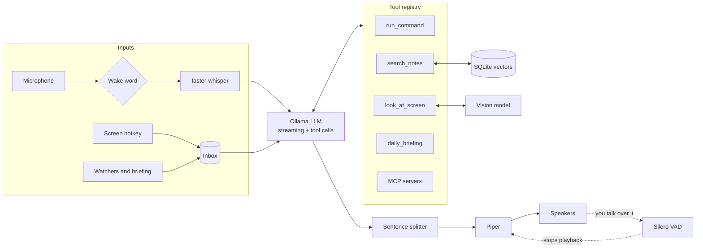

# Jarvis

A personal voice assistant that runs entirely on your own computer. It talks back while it's still thinking, and you can cut it off mid-sentence. It answers from your own notes and code, looks at your screen when you ask, plugs into apps through the Model Context Protocol, and speaks up on its own when something needs your attention.

No cloud APIs, no API keys, nothing leaves your machine.

```
You:    "Hey Jarvis, where did I write that auth fix?"
Jarvis: "It's in your notes file auth.md. The token was expiring too early, so you raised the TTL to an hour."

[Ctrl+Alt+J on a red terminal]
Jarvis: "Taking a look. You're missing the requests package. Run pip install requests and try again."

[8:30 am]
Jarvis: "Morning. You've got standup at ten and a design review at two. The jarvis repo has three uncommitted changes."
```

For a plain-language walkthrough of how all of this fits together, read [docs/HOW-IT-WORKS.md](docs/HOW-IT-WORKS.md).

## Features

| Feature | What it does | Built with |
|---|---|---|
| Streaming voice | Speaks the first sentence while the model is still writing the rest. Optional barge-in lets you interrupt. | Ollama streaming, Piper, Silero VAD |
| MCP agent | Connects to any Model Context Protocol server (files, git, calendar, browser) and exposes its tools to the model. | `mcp` Python SDK |
| Second brain | Indexes your notes, PDFs and code locally and answers questions from them, citing the file. | Ollama embeddings, SQLite, NumPy |
| Screen vision | A hotkey or "look at my screen" sends a screenshot to a local vision model. | mss, Qwen2.5-VL or LLaVA |
| Proactive mode | Battery, disk, meeting and build-log watchers, plus a daily briefing, with quiet hours. | psutil, icalendar |
| Safe actions | Allowlisted shell commands with spoken confirmation, and per-server confirmation for MCP tools. | Pure-Python policy, fully tested |

Everything is optional and switched on in `config.yaml`, so the basic voice assistant still runs on a modest laptop.

## How it works



### Project layout

```
jarvis/
  cli.py          entry point; wires optional features together
  assistant.py    conversation loop, tool-call loop, inbox
  persona.py      Jarvis's system prompt and the TTS cleanup filter
  llm.py          Ollama client: streaming chat, vision, embeddings
  streaming.py    turns token streams into speakable sentences
  voice.py        Speaker (pipelined synth and playback), Silero VAD, barge-in
  tools.py        tool registry and the shell-command safety policy
  mcp_client.py   connects MCP servers and registers their tools
  knowledge.py    second brain: chunking, embedding, vector search
  vision.py       screenshots, the vision model call, the global hotkey
  watchers.py     battery, disk, meeting and log watchers, briefing, scheduler
  audio.py        shared microphone stream and end-of-speech detection
  stt.py, tts.py, wakeword.py
scripts/
  download_voice.py     fetches a Piper voice
  install_startup.ps1   start Jarvis when you sign in to Windows
tests/                  30 tests, no models or mic needed
```

## Setup

You need Python 3.10 or newer. Disk use depends on what you turn on: about 6 GB for the basics, plus about 6 GB more for vision.

### 1. Install Ollama and the models

Download Ollama from [ollama.com/download](https://ollama.com/download), then pull what you need:

```bash
ollama pull llama3.1:8b          # the brain (required)
ollama pull nomic-embed-text     # second brain (small)
ollama pull qwen2.5vl:7b         # screen vision (needs a GPU with about 8 GB, or try llava:7b)
```

On a machine with less than 16 GB of RAM, use `llama3.2:3b` as the main model.

### 2. Get the code and install

Clone the repo (replace the URL with your own), or download and unzip the source into a folder named `jarvis`.

Windows (PowerShell):

```powershell
Expand-Archive $HOME\Downloads\jarvis.zip -DestinationPath $HOME   # skip if you cloned
cd $HOME\jarvis
python -m venv .venv
.venv\Scripts\Activate.ps1          # if blocked: Set-ExecutionPolicy -Scope CurrentUser RemoteSigned
pip install -e ".[all]"
python scripts\download_voice.py
copy config.example.yaml config.yaml
```

macOS and Linux:

```bash
cd jarvis
python3 -m venv .venv && source .venv/bin/activate
pip install -e ".[all]"
python scripts/download_voice.py
cp config.example.yaml config.yaml
```

Then open `config.yaml` and set your own folders, repos and calendar file. To install only part of it, pick extras instead of `all`, for example `".[voice,brain]"`.

Platform notes:

- **MCP servers** need [Node.js](https://nodejs.org) for `npx` servers and [uv](https://docs.astral.sh/uv/) for `uvx` servers.
- **Linux:** `sounddevice` needs PortAudio: `sudo apt install libportaudio2`. The hotkey needs an X11 session.
- **macOS:** allow microphone, screen recording and accessibility access for your terminal when asked.
- **NVIDIA GPU:** set `stt.device: cuda` and `stt.compute_type: float16` for faster transcription.

### 3. Run it

```bash
jarvis --index             # build the second brain once (later runs update it in the background)
jarvis                     # talk to it
jarvis --wake              # say "Hey Jarvis" first
jarvis --barge-in          # interrupt it by talking (use headphones)
jarvis --briefing          # get the daily briefing right away
jarvis --text              # type instead of talk, handy for testing
```

To have it start when you sign in to Windows:

```powershell
powershell -ExecutionPolicy Bypass -File scripts\install_startup.ps1
```

Say "goodbye" to exit.

## Things to say

- "What's my disk space like?" runs a safe command after you say yes.
- "Where did I write about the login bug?" searches your second brain.
- "What did I change in the jarvis repo today?" uses the git MCP server.
- "Look at my screen. Why is this failing?" uses vision. Or just press Ctrl+Alt+J.
- "Brief me." reads today's meetings, repo status and disk.

## The safety model

Letting a language model act on your machine deserves care. Everything goes through one place, `ToolBox.call` in [jarvis/tools.py](jarvis/tools.py).

1. **Shell commands** must be on `allowed_commands`. Pipes, redirects, `;`, `&&`, backticks and `$()` are rejected, commands run with `shell=False`, and destructive arguments like `git push`, `git reset`, `pip uninstall`, `-rf`, `--force` and `python -c` are blocked. Then Jarvis says what it's doing and waits for a spoken yes.
2. **MCP tools** confirm by default. Set `confirm: false` only for read-only servers, and use `allow_tools` to show the model just the tools you want.
3. **Screenshots** are only taken when you ask, go only to your local Ollama, and are never saved.
4. **Proactive alerts** only speak. Watchers never take actions.

## Development

```bash
pip install -e ".[all,dev]"
pytest
```

The tests cover the command policy, sentence streaming and code-block skipping, the speaker's interrupt handling, Silero VAD, the full tool-call loop, the inbox and hotkey flow, incremental indexing and semantic search, screenshot downscaling, every watcher, quiet hours, and a real MCP server started over stdio. None of them need Ollama, a mic, or downloaded models.

## Status

Work in progress. Typed mode, the second brain, MCP file tools and the briefing run on a real Windows laptop. Voice mode is not reliable yet on low-end hardware: on an 8 GB laptop with no GPU, replies take over a minute and the mic often isn't picked up. Hardware needs and a lighter voice pipeline are the next things to work on.

## Ideas for next steps

- Echo cancellation so barge-in works on laptop speakers.
- A small tray app showing the live transcript and what Jarvis is doing.
- Hybrid search (keyword plus vector) and reranking for the second brain.
- Recurring calendar events, and pulling the calendar straight from an MCP server.

## License

MIT
